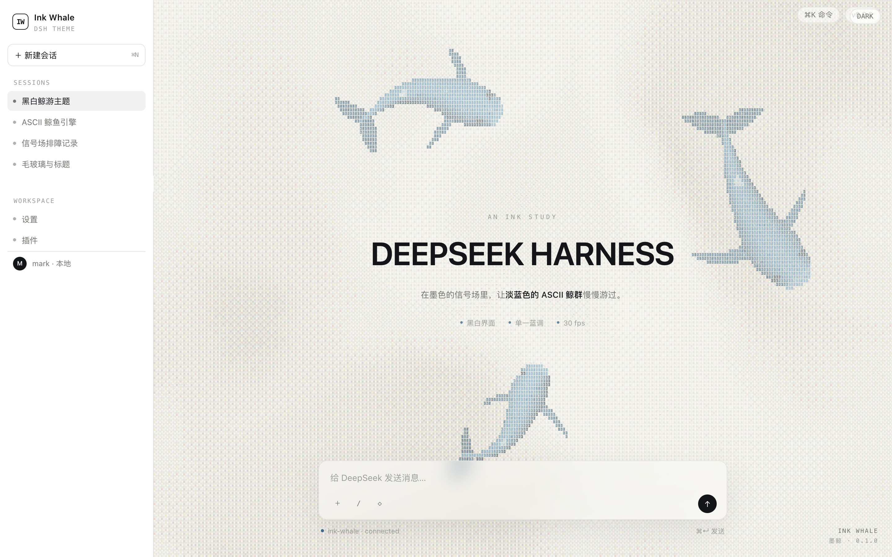
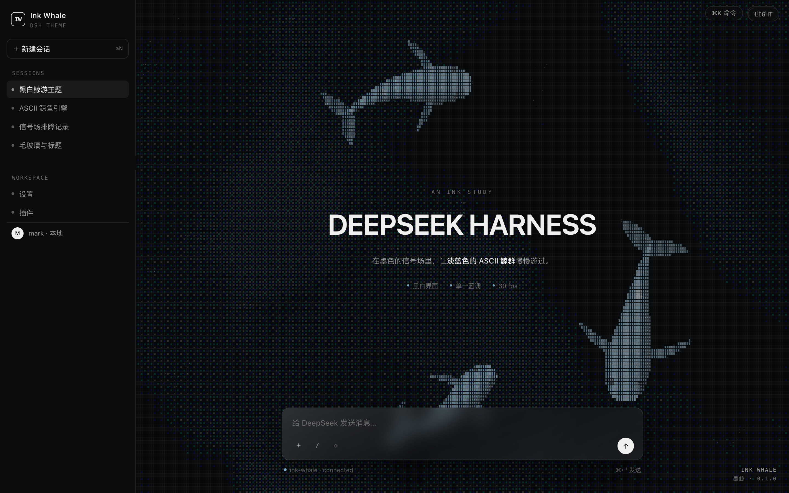

# 墨鲸 · Ink Whale

一个黑白 DSH 主题：墨色抖动信号场、蓝图式标题、毛玻璃输入框，以及一小群淡蓝色的
ASCII 鲸鱼，在界面上缓慢游过。

设计取自 [dsh-signal-field](https://dshthemes.com/t/dsh-signal-field/)（MIT，作者 Ycet），
本项目在其结构上重做了配色与鲸鱼材质：UI 全部收进黑白灰，蓝色只留给鲸鱼。

| 亮色 | 暗色 |
| --- | --- |
|  |  |

## 功能

- **黑白界面**：把 DSH 的品牌蓝、DeepSeek 蓝与紫色静态令牌映射成中性墨阶；
  红 / 绿 / 琥珀等语义色保留，报错和成功状态仍然可辨。
- **墨色信号场**：Bayer 有序抖动生成的连续场，随指针揭示 / 擦除，带点击涟漪。
- **蓝图标题**：文字被拆成字形贴图，指针靠近时出现虚线选框与尺寸标注；
  空闲扫光默认关闭，可在设置里打开。
- **淡蓝 ASCII 鲸鱼**：新建会话页默认三条，聊天页默认两条；两页各自可在设置里从 1 条调到 20 条。
  暗色为 `#9bcbe8` 冰川淡蓝，亮色用 `#5b93b5` 压深一档；鱼群与浮游颗粒只走灰阶。
- **毛玻璃**：输入框与 HUD 面板的玻璃层改为中性墨色，不再带蓝。
- **逐页开关**：新建会话页与聊天页各有独立的背景 / 标题 / 鲸鱼 / 玻璃参数，改动即时生效。

## 安装

本地开发用 link 方式安装：

```bash
dsh plugin --profile web add link:/Users/mark/Code/dsh-ink-whale
```

安装后重启 DSH（或重新打开 Web 界面）。卸载：

```bash
dsh plugin --profile web remove dsh-ink-whale
```

## 使用

打开 **设置 → Ink Whale**：

- **Master switch**：总开关，关闭后不注入样式、不建 canvas、不跑动画，界面回到原生 DSH。
- **Animation redraw cap**：帧率上限；窗口失焦时信号场自动降到 8 fps。
- **New session page / Chat page**：两页分别控制背景、标题、鲸鱼、玻璃与各自的动态参数。
- 鲸鱼的数量、大小、速度、摆尾、转向、透明度、鱼群数量都可以在页内继续展开调整。

偏好保存在浏览器本地（`localStorage`，键名 `dsh-ink-whale:v1`）。

## 构建

源码在 `src/`，构建脚本会把模块按顺序拼成单文件 `client.js`：

```bash
node scripts/build.mjs
```

改动 `src/` 后必须重新构建；DSH 只加载构建产物 `client.js`。

## 结构

```
src/
  styles.js        注入样式：令牌墨阶、图层、毛玻璃、设置页外观
  stage.js         舞台：检测页面、挂载信号场 / 鲸鱼 / 标题、逐页同步
  field.js         信号场引擎（WebGL2 两趟 pass）
  glsl.js          波形场与 Bayer 抖动着色器
  whale-engine.js  ASCII 鲸鱼引擎（Canvas2D）
  whale-field.js   鲸鱼图层适配器
  techtext.js      蓝图标题
  settings.js      设置模型、默认值与持久化
  settings-page.js 设置界面
  page.js / client.js / locale/
scripts/build.mjs  构建
preview/           独立预览页与截图（不参与插件运行）
```

## 说明

- 标题的虚线标注默认只在指针靠近时出现；如果喜欢原主题那种空闲时自动扫过的效果，
  可以在 Headline 的动效设置里打开 idle 扫光。
- 鲸鱼是整片界面里唯一的彩色元素；如果希望更克制，把鲸鱼透明度降到 0.35 左右即可。
- 主题尊重 `prefers-reduced-motion`。

## 许可

MIT。参考实现与第三方素材的许可见 [LICENSE](LICENSE) 与
[THIRD_PARTY_NOTICES.md](THIRD_PARTY_NOTICES.md)。
